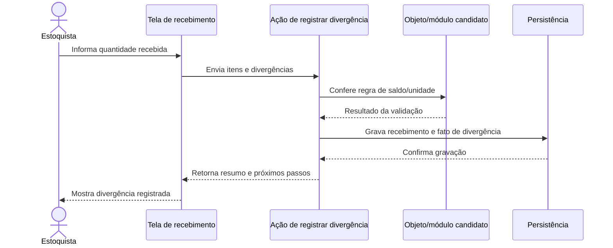

# Diagramas Mermaid para explicar interações

Mermaid é uma forma de escrever diagramas como texto. Use diagramas como **opção visual** para explicar chamadas, fluxo, responsabilidades ou estados — não como substituto da história, Ficha, evidência ou Cartão de Decisão.

## Quando oferecer

- Crie sempre que a pessoa pedir Mermaid ou diagrama.
- Se não pediu, **ofereça** quando houver vários participantes/componentes, decisões, transições ou integração que fique difícil acompanhar em prosa. Não desenhe por obrigação para um fluxo trivial.
- Em `--learn`, pergunte o que a pessoa colocaria e construa o diagrama junto; explique símbolos novos em uma linha.
- Em `--job`, ofereça uma versão curta quando ajudar a decisão/Brief; gere-a se a pessoa aceitar ou pedir diretamente, e diga quais limites ficam fora.
- Em **Herdar**, desenhe o fluxo observado, marque hipótese separada de confirmado e cite evidência `arquivo:linha`. Em **Operar**, não use diagrama como prova de saúde/telemetria.
- Só grave um arquivo de diagrama no repositório com permissão; caso contrário, apresente o bloco Mermaid na resposta.

## Escolher o tipo

| Preciso mostrar | Mermaid | O que representa |
|---|---|---|
| Quem envia mensagem para quem e em que ordem | `sequenceDiagram` | Interações no tempo; primeira escolha para fluxo de aplicação/integração |
| Caminho com decisões e alternativas | `flowchart TD` | Passos, decisões e resultados |
| Estados válidos e transições | `stateDiagram-v2` | Ciclo de vida de compromisso |
| Candidatos a classes/estruturas e relações | `classDiagram` | Modelo estático proposto, não prova do código existente |
| Dados persistidos e cardinalidade | `erDiagram` | Estrutura de armazenamento observada/proposta, não classes automaticamente |

Desenhe só o trecho que responde à pergunta. Não force diagrama de classe quando a dúvida é de fluxo, nem ER quando se está decidindo responsabilidade. Em diagramas sobre código existente, use rótulos **confirmado**, **declarado/não verificado** e **hipótese** quando necessário.

## Papel humano e papel do software

- Em `sequenceDiagram`, use `actor` para pessoa ou sistema externo que inicia uma ação; não crie uma classe `Estoquista` apenas porque o estoquista executa o trabalho na vida real.
- `participant` representa uma parte do fluxo de software (tela, porta/API, ação, objeto, persistência). Nomeie a responsabilidade; não use os rótulos como se já fossem classes implementadas.
- A folha não interage sozinha: a seta deve indicar quem/que evento acionou o software e qual chamada/mensagem ocorre. Uma referência entre dados não é uma ação.
- Use `classDiagram` só depois de identificar os candidatos e responsabilidades. Marque a estrutura como hipótese/proposta até confirmação.

## Exemplo: registrar divergência no recebimento

Esboço didático de uma **possível** sequência; a organização concreta deve ser validada contra o projeto e o domínio. O estoquista é ator, não uma classe automática.

O diagrama não decide ainda se a regra de saldo pertence a um objeto `Estoque`, a uma ação ou a outro módulo; isso é uma decisão de domínio. Na versão `--learn`, peça à pessoa para propor as setas e responsabilidades antes de apresentar esse exemplo. Em Herdar, substitua os nós por componentes realmente encontrados e cite seus arquivos/linhas.
